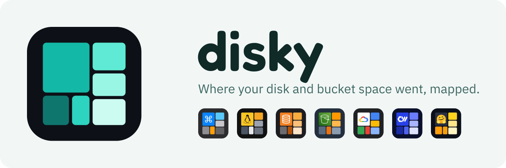
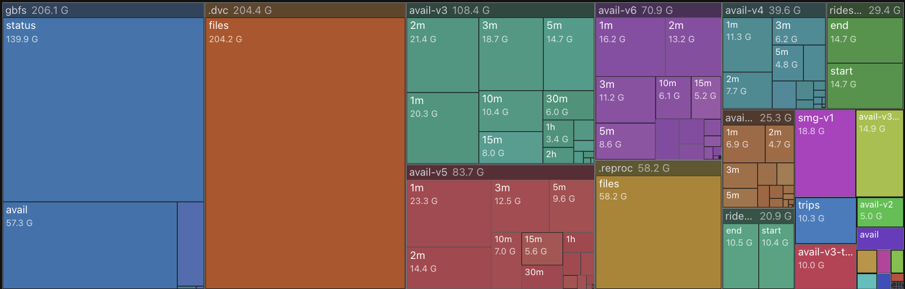

# disky

<picture>
  <source media="(prefers-color-scheme: dark)" srcset="site/public/icons/banner-dark.svg">
  
</picture>

Cloud storage analyzer: a scanning/indexing CLI for S3 / R2 / GCS buckets, and a Cloudflare-hosted treemap site (`site/`) over its indexes.

[](https://r2.rbw.sh/r2/ctbk)

<p align="center"><b><a href="https://r2.rbw.sh/r2/ctbk">▶ Live demo</a></b> — interactive treemap of a 916&nbsp;GB R2 bucket (drill in, filter, compare), from <a href="https://ctbk.dev">ctbk.dev</a></p>

<!-- toc -->
- [Install](#install)
- [Site](#site)
- [CLI](#cli)
  - [Examples](#examples)
- [Notes](#notes)
  - [Output](#output)
  - [Performance](#performance)
<!-- /toc -->

## Install

From a clone (one uv workspace: the engine plus the `dt-cloud` overlay in `cloud/`):

```bash
uv sync                                     # engine (`disk-tree` CLI)
uv sync --all-packages --all-extras         # + dt-cloud, every extra
```

## Site

`site/` is a Vite + React app with Cloudflare Pages Functions over a path index of each scan (in R2 / GCS, with D1 for the index footers): treemaps you can drill into, filter, diff between scans, and an age lens. Zero-dependency DIY-SVG/canvas ([`@open-athena/treemap`](packages/treemap)), no chart lib. Try it on the [live `r2://ctbk` demo](https://r2.rbw.sh/r2/ctbk).

## CLI

```bash
disk-tree --help
# Commands:
#   bulk-list       Bulk-list `URI` (e.g. `gcs://bucket`) to sharded listing parquet at `--out`.
#   import          Import one or more buckets from listing parquet(s) as canonical scans.
#   listing-format  Print each parquet's layer-2 listing format (v1 | v2), …
#   recompress      Rewrite old-format (v1) layer-2 listings as v2 in place, …
#   tiers           The path store's sorts: cut them from a layer-2 (`cut`), …
```

A bucket's scan is two steps: `bulk-list` shards its object listing across workers (`gcs://`, `s3://`, or `r2://` with `-E <endpoint>`), then `import` aggregates the listing into a canonical per-path layer-2 parquet (`path`, `size`, `mtime`, `kind`, `n_desc`, `n_children`, `depth`, …).

### Examples

```bash
disk-tree bulk-list -a s3://ctbk -o work/listing/ctbk
disk-tree import -e stream -s s3 -b ctbk -l 'work/listing/ctbk/shard-*.parquet'
# importing ctbk (engine=stream)…
#   s3://ctbk: … rows @ … → <uuid>.parquet
```

`dt-cloud path-index` (in `cloud/`) cuts the site's path store from the same listings.

## Notes

### Output

`import` writes each bucket's layer-2 to `~/.config/disk-tree/scans/<uuid>.parquet` (or `--to <dir|url>`), with a `Scan` row in `~/.config/disk-tree/disk-tree.db`. Override the root with `DISK_TREE_ROOT`.

### Performance

- **Listing**: `bulk-list` shards a large bucket's listing across processes (`-a`: adaptive range-splitting)
- **Aggregation**: `import -e duckdb` (out-of-core) / `-e stream` (O(depth) over sorted listings) for buckets past RAM
- **Depth-based predicate pushdown**: rows are sorted `(depth, path)`, so parquet reads prune row groups by depth and path prefix

### Marks

Each deployment's favicon and badge is a small treemap in its store's colors, with a store glyph in the big tile: `scripts/marks/build.mjs` writes them to `site/public/icons/`, a site deployment picks its favicon with `MARK` in its `wrangler.toml` (unset: a badge of its label's initials), and a union view's sources name theirs as `icon: "/icons/<key>.svg"` (`STORES_JSON`). Glyph credits:

- **NAS / Linux**: Tux, by Larry Ewing with The GIMP; path data from [Simple Icons] (CC0).
- **Hugging Face**: 🤗 from [Noto Emoji] (Apache 2.0), not Hugging Face's own logo.
- **Cloudflare R2**: the R2 icon from [Cloudflare's docs][cf-docs] (CC-BY 4.0; the license grants no trademark rights).
- **Amazon S3**: AWS's S3 service icon (via Simple Icons v9). AWS permits its architecture icons in diagrams and documentation; use as a product badge is a grey area.
- **CoreWeave**: CoreWeave's mark, used to name the store it scans.
- **macOS** uses the ⌘ symbol, and **Google Cloud Storage** a generic cloud in Google's four colors; neither uses a vendor logo.

All names and marks belong to their owners; disky is not affiliated with or endorsed by any of them.

## Development

```bash
# Python
uv sync
pytest tests/

# Site
pnpm install
cd site
pnpm dev
```

[Simple Icons]: https://simpleicons.org
[Noto Emoji]: https://github.com/googlefonts/noto-emoji
[cf-docs]: https://github.com/cloudflare/cloudflare-docs
