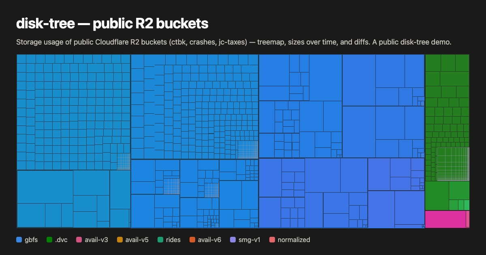

# disky: Marin GCS usage



*The public preview: cells are sized by bytes and coloured by top-level prefix, with names, sizes, owners, and costs omitted. The [site][gcs.oa.dev] shows all of them to signed-in users.*

Storage-usage attribution and cleanup for the Marin GCS buckets: **who is using
what**, and a **staged-deletion** workflow to reclaim space. Browse it at
**[gcs.oa.dev]** (Open-Athena-gated).

This repo carries one branch per [disky] deployment: `gcs` (the default, this README), `cw`, `hf` and `r2`, each merging the shared `cloud` base.

The identity map (`cloud/src/dt_cloud/identities.yaml`: handles, teams, login
aliases) is curated in-repo; it maps already-public GitHub / W&B handles to a
team bucket (`oa` / `stanford` / `communal`) and carries no emails or private
contact info.

## Ownership & staged deletion

> **Using an agent?** Point it at **[API.md](API.md)** (also served at **<https://gcs.oa.dev/llms.txt>**) and ask it to find your stuff, stage what's deletable, and assign what you know the owner of. It covers the token, the HTTP API, and copy-pasteable `curl` + `jq` recipes.

Anyone signed in can **stage** prefixes for deletion — the trash gesture in the
map, or `POST /api/plans/stage`; admins review the shared plan at
[gcs.oa.dev/staged](https://gcs.oa.dev/staged) and dispatch the executor (a GCP
Batch job, dry-run first). Nothing is deleted at stage time. Ownership is the
other axis: anyone signed in can assign a prefix to anyone, themselves included
(`POST /api/actions`), and `/users` ranks everyone's estate.

The earlier opt-out "mark & sweep" model (keep/sweep marks + a deadline) was
retired on 2026-09-28.

## Attribution pipeline

Attribution parquets (`prefix → user/team` rows) come from two builders:

```bash
# Path + record signals from the listing itself:
dt-cloud build -l 'gs://<bucket>/<scan>/objects/*.parquet' -o tmp/attribution.parquet
dt-cloud build -l <listing> -o <out> -R   # path signals only (no GETs)

# W&B signals (the bulk of coverage):
dt-cloud wandb-mine -e marin-community -o tmp/wandb-runs.parquet   # full API mine (time-bisected; -E/-s/-u for parallel range workers)
dt-cloud executor-mine -l <listing> -o tmp/executor-infos.parquet  # .executor_info sidecar GETs
dt-cloud wandb-attr -r tmp/wandb-runs.parquet -x tmp/executor-infos.parquet -l <listing> -o tmp/attribution-wandb.parquet
```

Reporting and the site consume any number of attribution parquets (`-a`, repeatable):

```bash
dt-cloud attr-report -l <listing> -a <attr...>       # per-user/team bytes + coverage; -u <user> prints their prefixes
dt-cloud gaps -l <listing> -a <attr...> -d 2         # largest unowned prefixes (curation queue)
dt-cloud webdata -l <listing> -d <asof> -a <attr...> # site snapshot → site/public/data/<asof>/ (+ scans.json index)
dt-cloud rules -o site/public/data/rules.json        # validate identities.yaml; export rules for the site
```

Signals, roughly best-first (deepest-prefix-wins at join time):

1. W&B run-config writer paths (`base_path` & friends — checkpoint/output dirs the trainer wrote)
2. W&B run-name ↔ dir joins under `checkpoints/`/`grug/`
3. `.executor_info` → W&B run joins
4. `users/<seg>/` path prefixes ([marin#6790] namespacing)
5. `.artifact.json` sidecars → `provenance.built_by`
6. manual `prefix_owners` for big shared trees (datasets, sweep namespaces)

Users/teams are re-resolved against the *current* `identities.yaml` at load
time, so alias/team curation takes effect without rebuilding parquets. Unknown
spellings resolve to their own sanitized segment with team `unknown` and are
listed on stderr — curate them into `identities.yaml` (`dt-cloud rules`
validates it).

Listing-scale runs (34M+ dirs) belong on a work node, not a laptop.

## Access ([gcs.oa.dev])

The viz site is app-gated: sign in with any Google account, or have a one-time code emailed to you, and the app then checks the signed-in email against an allowlist it owns (a D1 table, edited by admins at `/admin/db/allowed_emails`; removals take effect immediately). Invited guests can also be issued personal share links. To be added, ping Ryan (Discord) or ask any admin.

## Reports

The daily job posts the same digest to Slack `#gcs-usage` and Discord `#gcs-usage` (Marin's server): one thread per month whose OP (month-to-date headline, per-week bullets, a class-mosaic plot) is edited in place, plus one reply per scan under a headline sender with a colour-coded trend-arrow avatar. Mondays add a week-over-week report (totals, sweep deletions, biggest movers with owners). Code: `cloud/src/dt_cloud/digest.py` (`dt-cloud digest [-P discord]`) and `weekly.py` (`dt-cloud weekly`); design notes in `specs/done/slack-digest-shape-c.md`, `specs/done/discord-digest-twin.md`, and `specs/weekly-discord-report.md`. Posting goes through [thrds] (per-message sender + attachments on both platforms).


*The thread OP's plot for August 2026, redacted: the shape of the month and the class mix, with the sizes left off. The posted version carries the axis values and the running total; since October the site renders it (`/api/digest-image`, `kind: 'tiers'`), not matplotlib.*

## Repo layout

Monorepo — a shared engine plus the Marin-specific app and site:

- **`cloud/`** — the `dt-cloud` package (its CLI: attribution
  builders, reporting, the mark & sweep ledger client, access-log ingest).
- **`src/disk_tree/`** — the disk-tree engine (indexing, tree aggregation,
  storage backends), shared by every [disky] deployment on its `cloud` branch;
  installed as the root `disk-tree` package.
- **`site/`** — the [gcs.oa.dev] web app: a Cloudflare Pages SPA (treemap +
  browse + mark UI) with Pages Functions serving `/data` and `/api/*`.

### Marks

Each deployment's favicon and badge is a small treemap in its store's colors, with a store glyph in the big tile: `scripts/marks/build.mjs` writes them to `site/public/icons/`, a site deployment picks its favicon with `MARK` in its `wrangler.toml` (unset: a badge of its label's initials), and a union view's sources name theirs as `icon: "/icons/<key>.svg"` (`STORES_JSON`). Glyph credits:

- **NAS / Linux**: Tux, by Larry Ewing with The GIMP; path data from [Simple Icons] (CC0).
- **Hugging Face**: 🤗 from [Noto Emoji] (Apache 2.0), not Hugging Face's own logo.
- **Cloudflare R2**: the R2 icon from [Cloudflare's docs][cf-docs] (CC-BY 4.0; the license grants no trademark rights).
- **Amazon S3**: AWS's S3 service icon (via Simple Icons v9). AWS permits its architecture icons in diagrams and documentation; use as a product badge is a grey area.
- **CoreWeave**: CoreWeave's mark, used to name the store it scans.
- **macOS** uses the ⌘ symbol, and **Google Cloud Storage** a generic cloud in Google's four colors; neither uses a vendor logo.

All names and marks belong to their owners; disky is not affiliated with or endorsed by any of them.

## Storage growth

[`docs/cs3.md`](docs/cs3.md): what each prefix of the data bucket and its R2 copy grows with, what bounds it, and what's still open (the goal: storage proportional to changes in the fleet, not to scans).

## Development

The `dt-cloud` CLI lives in `cloud/`:

```bash
cd cloud
uv sync
uv run pytest
```

Two marin contracts are deliberately mirrored (not imported) to keep this repo
standalone; if either changes upstream, update in lockstep:

- `cloud/src/dt_cloud/usernames.py` — `sanitize_username` rules, mirror of
  `rigging.provenance.username_segment`
- `cloud/src/dt_cloud/records.py` — the `.artifact.json` shape
  (`marin.execution.artifact.ArtifactRecord`), of which only
  `provenance.built_by` is read

For the web app (`site/`), see [`site/`](site) — `./dev` runs the full local
stack (Vite UI + `wrangler pages dev` for the Functions).

[gcs.oa.dev]: https://gcs.oa.dev
[disky]: https://github.com/runsascoded/disky
[marin]: https://github.com/marin-community/marin
[marin#6790]: https://github.com/marin-community/marin/issues/6790
[thrds]: https://github.com/runsascoded/thrds
[Simple Icons]: https://simpleicons.org
[Noto Emoji]: https://github.com/googlefonts/noto-emoji
[cf-docs]: https://github.com/cloudflare/cloudflare-docs
