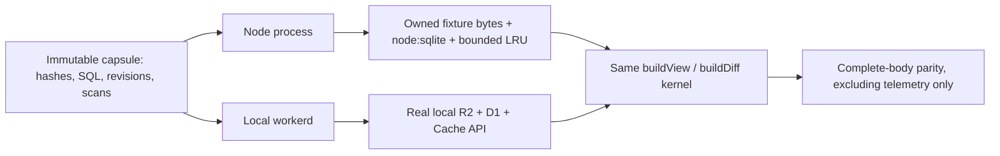

# Portable reader correctness harness

This wraps the production `buildView` / `buildDiff` kernel. It adds no deployed route and changes no production executor selection. The public boundary contains reader configuration, an immutable capsule identity, plain-text query inputs, scope/rendering options and explicit execution limits; it contains no auth identity, credentials or Cloudflare binding.



Run on the dev node, from the repository root:

```bash
scripts/remote-test --executor
scripts/remote-test --site functions/_lib/readerStops.test.ts functions/_lib/intervalStore.test.ts functions/_lib/staticFilter.test.ts
```

Or, after installing the frozen workspace dependencies on that node, from `site/`:

```bash
pnpm executor:parity
pnpm executor:build
node ../tmp/executor/cli.mjs capture ../tmp/executor/capsule.json .
node ../tmp/executor/cli.mjs run ../tmp/executor/capsule.json . < requests.jsonl
```

The `run` command accepts one `KernelRequest` per line and writes one result per line. `capture` reads only the tracked synthetic `fixtures/iv/interval-store/g1` files and canonical empty schema, then adds a synthetic ownership assignment. It does not discover or download deployment data. Hashes cover every object, the metadata SQL, scan list and reader configuration. The ordinary-process adapter verifies and owns at most 16 MiB of fixture bytes before serving, so later filesystem changes cannot change a pinned answer. This fixture adapter is intentionally bounded; a production filesystem adapter and hosted transport are later work.

The parity runner uses two separate capsules/processes: ordinary small-corpus reads and indexed-only refusal cases. Each runtime binds one capsule for its lifetime. That is an enforced restriction, because several existing kernel memos assume one deployment per isolate; clearing a few caches would not establish safe arbitrary capsule switching. The harness compares the entire semantic result, including identities, totals, counts, remainders, scopes, partial flags and refusals. It also checks a literal golden root total (20 bytes, three objects, including a zero-byte object), rather than accepting agreement between two equally broken readers.

Cold means the first pass in a fresh process/isolate, not an independently cold cache for every case; later cold-pass cases may reuse earlier cases' reads. Warm is the second pass. The final pass uses concurrency two. Caller read/byte limits are exercised before warm-up and must not mark immutable runs broken. The hard wall-clock limit is cooperative at I/O and decode boundaries; it does not preempt a synchronous JavaScript section or cancel filesystem work already issued. Origin GET/byte accounting belongs to the request that starts shared work, not every joiner.

`tmp/executor-parity/samples.jsonl` and its `indexed/` counterpart record full response time, serialization time/size, origin reads/bytes, decoded row passes (metadata and repeated column passes included), inclusive decode elapsed time, trace phases, Node process CPU and RSS. Node CPU is measured only around the Node execution; concurrency samples cannot attribute process-wide CPU/RSS to individual overlapping calls. Worker CPU/memory and aggregation-only CPU are explicitly null: these require runtime profiling, and elapsed decode time is not a CPU measurement. No speedup or complete CPU breakdown is established by this harness.

## Dependency inventory

| Seam | Worker production | Ordinary-process capsule |
|---|---|---|
| Objects, suffix/range reads, manifest listing | `readerObjects`: existing R2 read binding | Hash-verified, owned fixture bytes |
| Metadata and ownership ledger SQL; derived ownership caches | `readerMetadata`: D1 statement/batch adapter | Actual in-memory `node:sqlite` initialized from captured SQL |
| Snapshot/extras reads | Existing S3/R2 store selection | `filesFromObjects` over the same frozen object set |
| Cross-isolate response/index cache | Existing Cache API | Explicit bounded memory LRU |
| Cache context | Existing Worker default | `runReader` async context; no fabricated `globalThis.caches` |
| Clock and decoder | Standard `Date`/`performance`; existing hyparquet/fzstd | Same standard clock and decoder |
| Cancellation/budgets | Existing request ownership; no production limit changes | Explicit signal and deadline/read/byte/output limits |
| Background scheduling | Existing HTTP edge remains responsible | No `waitUntil`, remote jobs or auth in the boundary |

The kernel still lives in `site/functions/_lib`, and its internal historical `Env` type remains coupled to the site's type definitions. Per-scan metadata cache services are not independently portable yet; the acceptance capsule uses the current interval-store serving path. Remote transport, capability authorization, production adapters, automatic routing and arbitrary multi-capsule process pooling remain outside this implementation.
