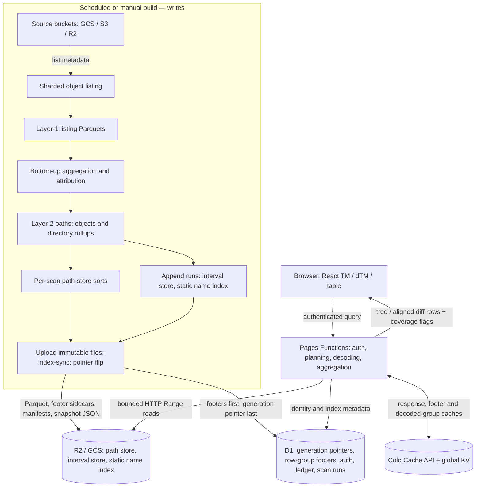

# Serverless architecture

As of 2026-10-14, on `cloud` and the deployments that merge it (gcs, cw-s3, the r2 demo, m3). Source links are relative to this repo. Per-deployment settings are in each branch's `site/wrangler.toml`; where a deployment differs, the text says so.

## 1. Shape of the system

The serving system is a React site on Cloudflare Pages; Pages Functions plan and aggregate; immutable artifacts sit in object storage (R2, or GCS for older per-scan generations); D1 holds generation pointers, row-group footers and application state; the Cache API and KV avoid repeated work. "Serverless" describes serving: scanning and building run as batch jobs, not in a Worker, and nothing on the query path is an always-on server. [Serving reader][index-source]



A treemap request does not list live buckets or rebuild a scan: it reads an already-published generation. Query handling can fill caches and auth bookkeeping, but never modifies source objects, indexes or ownership. Owner actions, staged-deletion plans and admin dispatch are separate mutation APIs; drawing a treemap never authorizes deletion.

## 2. Scanning, aggregation and publication

`disk-tree bulk-list` shards a bucket's listing into layer-1 Parquets; `disk-tree import` or `dt-cloud path-index` aggregates them bottom-up into layer-2 rows (objects with their own rows, directories with recursive totals), optionally sliced by owner. From the layer-2, a scan publishes up to three things:

- **Per-scan path store** ([path-store]): the `path` sort (depth, path) and the `bysize` sort (⌊log2 size⌋ desc, keyed on a path's total over owner slices), 8K-row groups, plus user-led copies. Every deployment cuts these.
- **Interval store** ([interval-store]): `dt-cloud interval-store append` adds the scan's changes as a run beside the generation's base; deferred carries merge runs on a binary counter. gcs prod has one (generation `2026-10-09b`); cw-s3, the r2 demo and m3 do not yet.
- **Static name index** ([static-name]): `dt-cloud static-names runs add` appends the scan's suffix, catalog, drill and anchor runs. gcs and cw-s3 build it; the r2 demo and m3 do not.

One append runner (`append_runner.py`) drives both stores' appends concurrently on Batch, with the D1 row staging. Publication keeps bytes and metadata coherent: upload every file a generation names, load its row-group footers into D1 (`index-sync`), and flip the generation pointer last. A reader pins the generation it opened. D1 holds footers for the newest ~30 per-scan scans; older ones are served from cold `.groups.parquet` sidecars without dropping the scan.

## 3. Why D1 does not hold the path database

`index_schema` identifies each scan's generation, store directory and schema; `index_row_groups` holds pruning statistics and compact Parquet group metadata. D1 selects candidate groups; it does not return matched paths or run the aggregation.

Depth/path order makes a directory's descendants at each depth a contiguous range. Group statistics prune by depth, prefix, size and owner. The Worker fetches metadata only for the selected groups, range-reads their projected column spans, decodes them with the JavaScript reader and applies exact row predicates. Adjacent spans merge to cut round trips, with a bounded number in flight. Physical pruning is coarse: a surviving group may hold mostly irrelevant rows. Parsing a large file's full footer in a cold Worker is deliberately avoided. [Index reader][index-source]

## 4. Authenticated request and cache path

```mermaid
sequenceDiagram
  participant B as Browser
  participant W as Pages Function
  participant D as D1
  participant C as Cache API / KV
  participant S as Artifact store
  B->>W: subtree(scan, path, scope, viewport, f) or diff(from, to)
  W->>D: Authorize viewer; resolve generation and ledger head
  W->>C: Look up versioned response key
  alt Response cached
    C-->>W: JSON
  else Cache miss
    W->>D: Select row groups for the pinned generation
    opt Retired D1 footers
      W->>S: Range-read cold footer sidecar
    end
    opt Name filter
      W->>S: Static name index: catalog, suffix shard or drill ranges
    end
    W->>S: Fetch selected merged column ranges
    S-->>W: Parquet bytes
    W->>W: Decode, filter, aggregate, fold / align diff
    W->>C: Store response (waitUntil)
  end
  W-->>B: Private JSON response with coverage and timing
  B->>B: Render TM / dTM; drill issues another scoped request
```

`requireViewer` precedes the cache lookup. Cache keys include the generation, query, path, quantized dimensions, scope and ledger head (the static filter's also carry a response-shape version, `RESPONSE_V`). The colo cache fronts a global KV cache; stored copies are internal, and responses to clients are rewritten to private caching, so a cache hit never bypasses the viewer gate. The interval-store reader additionally keeps its state, footers and decoded row groups in the colo cache across isolates. [Subtree route][subtree-source], [cache][cache-source]

## 5. Treemaps, diffs and the interval store

A TM reads a root aggregate, derives a byte threshold from the viewport budget, and selects drawable descendants with depth attenuation; the rest folds into `(other)`. Owner and storage-class lenses change the scoped aggregates. This is a bounded display, not a paginated listing.

On a deployment with an interval store (`PATH_STORE = "intervals"`), a scan the generation holds is read from it: each row is a path version live over `[vf, vt)`, so a view at scan `D` keeps the rows live on `D`, and a diff reads only the versions that changed between its two scans, bounded by the other scan's version. A view or diff reads only the runs begun by its scans. Scans outside the generation, and deployments without one, read the per-scan sorts. A dTM computes a shared threshold, aligns named paths and looks up counterparts that crossed it; output rows and point lookups are capped, and the response says so. [Diff implementation][view-source]

## 6. Name search

The map's filter (`?f=`) and `/names` are answered from the **static name index** on R2 ([static-name]), case-insensitive on basenames:

- A rare literal (suffix range ≤ V = 100K rows) is one contiguous range of a suffix shard, exact on every scan the generation covers.
- One- and two-character literals and heavy ones come from a catalog; the filtered map at any path reads the literal's match roots or, for heavy directories, per-child drill rollups.
- Anchored forms (`^q`, `q$`, `^q$`) read anchor catalogs where a deployment builds them (gcs).
- Long hex runs are indexed only by their last 8 digits ([static-hex-runs]), on cw-s3 so far.

gcs sets `FILTER_INDEXED_ONLY`: anything the index can't answer exactly (regex, globs, exclusions, compound terms, scoped filters, a scan not yet indexed, a term too common at this drill) is a 400 with a reason code, never a slow or approximate scan ([indexed-only][indexed-only-source]). Elsewhere those forms fall back to the path-store walk, marked approximate; the r2 demo can use the older trigram search sidecars ([path-store-search]). Gaps still open are in [search-extensions] and [index-landscape].

## 7. Scale limits

A treemap needs every matching contribution, not a first page of results, so the cost of an answer is aggregation, not retrieval. The static index bounds a query's reads (≤ ~116K rows for a non-member at V = 100K, decoded in under a second) by refusing what it can't bound. Run stacks grow with every scan until compaction folds them (not yet merged). Caching makes repeated immutable queries cheap but doesn't fix cold fan-out; D1 reduces footer overhead but is not a path index; daily builds stay proportional to the fleet. What was measured against this design, and why it won, is in [alternatives] and the [ClickHouse post-mortem][postmortem].

[index-source]: ../../site/functions/_lib/index.ts
[subtree-source]: ../../site/functions/api/subtree.ts
[cache-source]: ../../site/functions/_lib/edgeCache.ts
[view-source]: ../../site/functions/_lib/view.ts
[indexed-only-source]: ../../site/functions/_lib/indexedOnly.ts
[path-store]: ../done/path-store.md
[path-store-search]: ../path-store-search.md
[interval-store]: ../interval-store.md
[static-name]: static-name-search.md
[static-hex-runs]: ../done/static-hex-runs.md
[search-extensions]: ../search-extensions.md
[index-landscape]: ../index-landscape.md
[alternatives]: alternatives.md
[postmortem]: ../done/ch-postmortem.md
