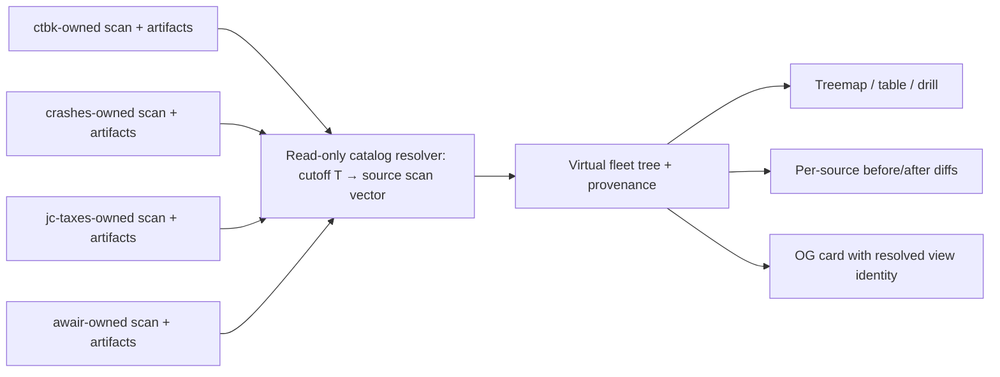

# Federated scans — portable per-location scans, a union reader, an embeddable viz

Status: **first shared implementation slice** (2026-10-13). Ryan confirmed project-owned scans/infra and a read-only aggregate dashboard, including Awair. The pure catalog/resolver/pin/diff model, tree/age/history adapters and reusable cutoff picker are implemented and tested on root. A development-only fixture at `/dev/federated-scans` exercises the picker three times over an unchanged treemap renderer. Live remote-source fetching, producer exports and production integration are not implemented yet. The Disky-owned daily union scan remains a migration bridge, not the target model.

## The idea

A scan is a **portable artifact** (`<uuid>.parquet` + `.scan.json`, as `index --to`/`reduce --to` already produce). Today disk-tree treats blob storage as a **search path** (multiple scan dirs unioned locally, `config.scan_read_dirs()`). Extend that to the web:

1. **Scans live beside the data they describe.** Each source bucket houses its own scans — inside it under a reserved prefix (`_disk-tree/` / `usage/`) or in a dedicated **sidecar bucket** (`<bucket>-usage`). Whoever owns/scans the bucket publishes there.
2. **The www reader unions multiple distinct scan locations — at read time.** A deploy is configured with a *list* of scan locations `{store, prefix, creds}`; the Map unions their roots (the union-of-roots concept, now over independent, separately-owned locations rather than one pre-merged index).
3. **The viz is embeddable per project.** The same widgets (`@rdub/treemap` + `@disk-tree/react`: treemap, sizes-over-time, age, staleness) render a *single* location embedded in that project's own site. e.g. ctbk / crashes / jct each surface their own bucket's usage (sizes over time, treemap) at their own `/files` page, reading their own sidecar — while r2.rbw.sh unions all three.

The through-line: **one scan artifact, many readers** — a project's own site (single location) and an aggregator (union of locations), both anonymous over public buckets.

## Near-term build (the stepping stone) — DT-owned daily r2 scans

- **disk-tree owns the r2 scans**: a daily DT ingestion job scans ctbk + crashes + jc-taxes and publishes to **one r2 index bucket** (union-at-ingest, cw-multi-bucket style). r2.rbw.sh reads that one index → the union Map (`specs/done/union-of-roots.md`).
- This is chosen for speed to a live deploy; it is a **special case** of the north-star where the "union of locations" happens at ingest into a single location, and DT owns all three scans.

## Design guardrails (so the stepping stone generalizes cleanly)

- **Keep ingestion output per-source**, not irreversibly merged — so a source's scans can later move to its own sidecar without re-deriving. (The union at ingest should be a *view*/manifest over per-source outputs, not a lossy merge.)
- **Reader points at any store** — done: `makeStore`/`storeCreds`/`storeReady` are env-generalized (`0862f37`). North-star step: generalize the single `Env` store to a **list of locations**, and union their roots in the reader.
- **Viz stays deploy-agnostic** — already true (the widgets are workspace packages; the static CFN reader is store-driven).
- **Anonymous over public buckets** — the r2 buckets are public, so the union reader and per-project `/files` embeds need the **public/no-gate auth mode** (a DT-lane item in `union-of-roots.md`; mgu's deploys all require a scope). Private locations later carry per-location creds.

## Phases

1. **(live migration bridge)** Single-union-index r2.rbw.sh — DT daily ingestion → one r2 index bucket → union Map. Retain this while replacing source ownership incrementally.
2. **Multi-location union reader** — reader config = N `{store, prefix, creds}` locations; union their roots at read time. r2.rbw.sh reads the three buckets' sidecars instead of a pre-merged index.
3. **Per-project embed** — publish the viz as an embeddable route/widget; ctbk/crashes/jct host it at `/files`, reading their own sidecar (single location).
4. **Sidecar ownership** — each project's own job writes its sidecar (or a dedicated sidecar bucket), using shared Disky CLI/library code. The aggregate deployment does not orchestrate source scans or hold source listing/write credentials.

## Open questions

- **Sidecar location convention**: reserved prefix inside the bucket vs a dedicated `<bucket>-usage` bucket. (Sidecar bucket keeps the data bucket clean and lets scan-write creds differ from data creds; in-bucket prefix is zero extra infra.)
- **Union reader auth**: public locations are anonymous; a private location needs its own creds threaded per-location (the `{store, prefix, creds}` shape already anticipates this).
- **Freshness across locations**: resolved by one shared as-of resolver and an explicit source vector, described below. Never manufacture a single fleet capture time or use a future scan for an earlier cutoff.
- **Relationship to the `ui/` superset**: the local scan-manager (`ui/`) already unions local scan dirs; the federated web reader is the same union concept over remote locations. They may converge on one union-reader abstraction.

## As-of view: one cutoff, several source snapshots

For cutoff `T`, select each configured source's latest successfully published, complete scan whose observation endpoint is at or before `T`. Merge those source roots into a virtual fleet root. The result is the latest observed state for each source before `T`, not an atomic fleet snapshot or a claim about every object's exact state at that instant.



The resolver returns an explicit vector `[{source, scan_id, revision, artifact_digest, observed_from, observed_through, freshness, coverage}]`. It resolves once for a view, not independently in every endpoint: a root TM, drill request, table and OG image must not straddle a newly published scan. A one-source drill reuses that vector's source entry, even if that source has published another scan since the fleet page loaded.

“Latest” captures one request cutoff and resolves all sources against it; it does not let each source choose a different wall-clock now. Catalog refresh can advance an unpinned view deliberately. A selected historical cutoff remains fixed. The default historical mode uses the best currently published observations before the cutoff, including later-published backfills; “only information published by T” would be a different audit mode, not silently mixed into this one.

### Observation time is not the scan-id string or publication time

An object listing is generally a capture interval, not an atomic snapshot. Producers publish both `observed_from` and `observed_through`; for a non-atomic listing, `observed_through` is the as-of eligibility time. A source with a genuinely atomic inventory timestamp can publish equal endpoints. Index construction/publication can finish later; `published_at` is separate operational provenance.

Legacy date-only IDs must not be treated as invented midnight instants. Use documented capture metadata when available. Otherwise advertise date precision explicitly and use a conservative end-of-day eligibility bound, with its timezone defined by the producer; no intra-day precision claim. Historical adapter policy must be tested rather than repurposing the current slug resolver's exact/day-prefix behavior.

### Missing, stale, failed and empty are distinct

- No eligible scan before T is unknown coverage, not an empty bucket. Do not substitute the first future scan.
- A genuinely empty, complete scan is a known zero.
- A failed/in-progress capture is not published as a new usable scan. The prior successful scan remains eligible; its age and capture window belong in picker/details, not repeated per-node notices.
- A source whose most recent eligible scan is old is carried forward, not silently dropped. Expose its observation time/freshness in picker/details; ordinary tree/table rendering does not need to announce asynchronous schedules.
- A known scan that cannot be read is unavailable. Retry/read the same immutable revision; do not silently resolve to another scan. A partial fleet view may still show the readable sources, but must say which sources are unavailable and label its total partial.
- A source omitted by configuration/authorization is not a zero-size source. Private artifacts require their own allowlist/auth treatment; never expose them through the public aggregate.

Totals are exact over the selected, readable artifacts and scoped coverage, subject to ordinary rendering budgets; temporal coverage is asynchronous. Source IDs/mount roots must be stable and cover disjoint data scopes, so the same objects are not counted twice through overlapping project exports.

## Publication and ownership boundary

Each project owns its schedule, execution identity, source-listing credentials, derived-artifact write identity, output storage, retention policy, and attributable IaC costs. Disky supplies the reusable producer/reader contract and example infrastructure; the aggregate owns only its serving/cache/config infrastructure and read-only access to intentionally exported artifacts.

A versioned source catalog lists complete immutable scan manifests. Each manifest declares source ID and mounted root, exported bucket/prefix scope, capture interval/precision, publication timestamp, stable scan ID and revision/content digest, byte/object totals, artifact format version, capabilities, and references to tree/path/bysize/footer/search artifacts. These are the current serving artifacts, not merely the early UUID layer-2 parquet assumption above. Publish artifacts first, validate required readers, then atomically advertise the manifest/catalog entry. Optional search capabilities are explicit; a query must not switch to an older source scan merely because that scan's search index is ready.

The aggregate may mirror small catalogs/footers into its own cache/D1 or maintain a metadata-only source-vector registry. That does not give it scan ownership or justify copying/rebuilding full fleets centrally. First delivery can compose existing source readers behind stable virtual mounts; efficient cross-source root requests fan out concurrently and combine bounded responses. A single-source drill delegates to that source's exact pinned revision. Keep fleet-wide byte thresholds/budgets consistent rather than independently granting every source a full fleet budget.

Compaction can relocate physical files without changing logical scan contents. Resolve logical references through the producer's routing manifest; pin the logical content revision/digest, not a transient archive filename. Producers must define retention/withdrawal explicitly. A pinned view whose scan was withdrawn reports unavailable, not another scan.

## Date picker and timeline

One compact control says “As of …” or “Latest observed”, not “Scanned at …”. It accepts an arbitrary timestamp and offers presets at the sorted union of source observation endpoints: those are the instants at which the composed state can change. Deduplicate simultaneous events, retaining the list of sources updated by each event.

Use a custom popover: day groups with project-labelled time chips arranged horizontally when space allows, wrapping/stacking on narrow screens. This is presentation grouping only; day grouping must not round the selected cutoff or collapse multiple intraday events into one fake scan. A daily preset, if offered, explicitly means end of that viewer-local day; URLs carry an unambiguous UTC instant. Provide “latest” and previous/next update navigation.

The picker includes an expandable source table: project, selected capture time/window and coverage; freshness/status can be added there as producer scheduling metadata becomes available. A drill keeps the fleet cutoff and pinned source reference. Source timing may be inspected in picker/details, but must not leak into every table row or treemap tile. Page-level notices are for meaningful unknown/unavailable coverage or read failures, not the mere fact that projects run at different times. Users should not need four separate pickers for the common case.

Use the same `FederatedScanPicker` for main as-of, diff-from and diff-to: three independently controlled instances with the same resolver/event semantics. Display groups use the viewer's timezone; exact input and serialized values are UTC ISO instants. The initial implementation exposes exact UTC text input, latest observed, previous/next events, wrapping project-labelled chips and source capture details, with keyboard/outside-dismiss and phone viewport constraints.

The picker cannot own the semantics alone. A source-aware resolution layer must also serve tree/table/totals, drilling, diffs, over-time and OG. Existing treemap layout and one-source parquet readers can remain largely unchanged behind that boundary.

### Diffs and over-time

Resolve both cutoffs independently, then diff each source's chosen before/after scans. An unchanged source reference contributes zero observed change. A missing/unavailable endpoint produces unknown change for that source, not an added/deleted bucket. Show totals for comparable coverage, with separately identified coverage/configuration changes; adding Awair to the dashboard is not storage growth.

The default federated over-time curve is a step function of latest observations at the union event times, not interpolation implying continuous fleet measurement. Sources contribute unknown before their first eligible scan and retain their last observation afterward, with coverage/freshness visible. A root total with incomplete coverage is partial. Source-specific charts can show their own scan samples directly.

The mtime/date-distribution renderer does not need a multi-source rendering mode. Combine the selected sources' absolute epoch-day rows, qualifying directory/group identities by their mount. Preserve each object's timestamp, owner/access facets and bin totals; never shift bins by source scan time. Any relative-age lens uses the shared selected cutoff, not a separate source-local “now”. The existing GCS-created versus S3/R2-modified distinction remains a timestamp-semantic issue, not a scan-schedule issue.

## URLs, caching and existing seams

Introduce an explicit as-of parameter (proposed `at=<UTC ISO instant>`, with a separate before cutoff for comparisons). Do not reinterpret `d=`, `date=`, or `scanArg` as nearest-prior lookup: today those resolve exact scans/day prefixes and reject misses. Preserve old single-union links via a legacy adapter; do not silently change their historical meaning.

A cutoff-only URL is a logical query and can resolve differently after catalog backfills/corrections. Stable sharing/OG adds a versioned view-manifest ID/content hash pinning source membership and scan content references. All data/cache keys carry that resolved vector plus query parameters, not just the cutoff or a date string. Staleness/partial-coverage status is part of the response, and pinned views must not be silently re-resolved.

Code seams requiring adapters: `src/scan.ts` consumes one `scans.json` and returns one `asof`; `_lib/scanArg.ts` selects a single store scan; `api/subtree.ts` keys by one date/generation; `api/series.ts` treats scan IDs as common observation points; OG resolves/pins one scan. `_lib/stores.ts` already supplies per-store read configuration, but is not a multi-project as-of union resolver and does not by itself remove the common D1 assumption.

## First implementation slices

1. **Implemented shared foundation:** `site/src/federatedScans.ts` validates source catalogs and immutable pins; resolves cutoff→vector; enumerates union events; distinguishes comparable deltas from coverage changes. `federatedViews.ts` composes pinned root responses, qualifies unchanged age rows, and emits carried-forward step values. `FederatedScanPicker.tsx` is exercised three times in the development-only fixture. Exact unit and browser regressions cover staggered scans, ties, pending publications, empty versus unknown, windows, backfills, withdrawals, stable pins, coverage changes, timezone grouping, URL independence, invalid dates, focus restoration and phone constraints. See [source catalog contract] for the producer boundary. No live reader/scheduler cutover has occurred.
2. Awair owner publishes a small complete export of the already-public `pyramid/` scope, using its own job/infra. Treat its existing shard health inventory as a discovery aid, not a complete scan manifest. No expansion of the aggregate's source-listing token.
3. Add an opt-in federated preview using Awair plus an existing source adapter; implement root totals/TM and one-source drill with provenance first. Add the custom cutoff picker and exact source freshness table, then diff/step history/OG against the same resolver.
4. Have ctbk, crashes and jc-taxes independently publish the contract. Keep legacy union history as a distinct source/legacy route during validation; never count it together with the same projects' new exports. Retire the centralized daily scanner only after its covered projects have working owner-side publications and readback checks. Preserve old artifacts/history and rollback.
5. Infrastructure changes and project-side jobs are owner-reviewed handoffs. This design does not authorize changing source bucket exposure, broadening tokens, applying another project's IaC, or deleting the current scanner/history prematurely.

## First live cases (2026-10-14)

Two concrete pairs ride slice 3's reader. Both are "N stores → one virtual root, a one-source drill delegates":

1. **r2 `/meta` beside the main map (in-deployment, the first build).** r2's main scan (marin-na, marin-discord, the cw and gcs index buckets) and its meta scan (its own serving bucket, `oa-r2-usage-index`, `job/r2-scan` `execute_meta`) are two stores of ONE deployment: same D1, same R2, and meta reuses the main scan's id. So the source catalog is local config (two `STORES_JSON` entries + a `union: [main, meta]` view), the cutoff vector is trivially aligned (one id), and nothing crosses an account. The main scan still never measures its own output; the union reader adds meta's root beside main's. This exercises tree/table/drill, diffs, series (step function), the age view and `?f=` (each store's static index answers for its own mount; a store without one is `scan-not-indexed` for that mount, never a walk) with no remote transport.
2. **cw + HF (cross-deployment).** HF gets its own stack (Storage Buckets via the S3 gateway `s3.hf.co/<namespace>`, repos via a small tree lister; its own D1/index bucket/domain), owned and scheduled on its own. cw's deployment adds it as a **remote source**: the catalog entry names HF's site origin plus a read-only grant token (`/api/token`), and the union reader fans root requests out to HF's API (`/api/subtree`, `/api/series`, …) concurrently with cw's own reads, then delegates HF drills to it with the pinned scan. API-level fan-out first (each stack owns its artifact format and version; no shared bucket credentials); reading HF's published artifacts directly is an optimization if the extra hop shows in latency. "Bytes moving between them" is the per-source step series (cw down, HF up) for free; a per-path "moved" diff needs a declared cw↔HF path mapping and is out of scope here.

Order: (1) first — it proves the reader without auth or transport; (2) reuses it with a remote adapter.

### Case 1 status

Config: a `STORES_JSON` entry with `union` is a **union view**, not a store (`site/functions/_lib/stores.ts`): `{"union": [<store>…], "main"?: true}`, members `primary` or secondary store keys (≥ 2, distinct, never another view), at most one `main`. `main: true` makes it what a request with no `store=` reads (the main map, no client change); `store=primary` is then the primary alone, `store=<view key>` the view either way. A deployment without a view is untouched (its requests never reach `_lib/union.ts`). r2:

```
STORES_JSON = '{"meta": {"vars": {…as today…}, "secrets": {…}}, "all": {"union": ["primary", "meta"], "main": true}}'
```

Resolution (`_lib/union.ts` `resolveUnion`): one cutoff — `date=<id>` (some member must index it, else the single-store 404) or `d=<slug>` (the latest any member indexes under it) — at that scan's instant (`scanInstant`); each member's scan is `latestObserved` (the catalog resolver's rule, factored out of `resolveFederation`) over its own indexed scans, so aligned ids pick the same id, a member on its own schedule carries its last scan forward, and a member with none by the cutoff is unknown (`date: null`), never its first later scan. Every member is gated (`requireViewer` on its own env) before anything is read: a union demands each member's scope.

- **Slice 1 — tree/table: done.** `/api/subtree` (the table reads the same endpoint, `depth=1`). Root: each ready member's root read concurrently through its own read path at its resolved scan, under one byte threshold from the union's total (`Σ root bytes · minArea / (w·h)`: one fleet budget, not one per member); merged by `unionRoot` — each member's top-level nodes tagged `src` (store) and `at` (its scan id), the members' `(other)`s summed into one, totals summed under the deployment's `ROOT_LABEL`, the resolved vector beside it (`union: {view, at, sources: [{store, date}]}`). A top-level name two members draw is a 500 (`UnionOverlap`), never a sum. Below the root: the member whose roots (`readRootRows` at its resolved scan) hold the first segment answers through `store=<member>` at its scan — byte-identical to asking that store directly; no member holding it is a 404. Cache keys: each member read keeps its own key, carrying its resolved scan; a union root's member reads add `&T=<threshold>` (the shared threshold, itself a function of the vector). The union root refuses the per-store axes (`lens`, `o`, `by`, `cl`: 400, "drill into one store"); a drill takes them (`q` is composed: slice 5). Tests: `functions/_lib/union.test.ts`, `functions/api/unionSubtree.test.ts` (fixture `v2-mount`: one `mb` root, beside `v2-search`'s `bk`/`zz`).
- **Slice 2 — series: done.** `/api/series` root: each member's own series (its own handler, cache and scans) concurrently, composed by `carryForward` (`federatedViews.ts`; `federatedSeries` now rides it too): one step per instant any member scanned, each member's latest point at or before it carried forward, none before its first. A point some member doesn't cover yet names it (`missing: [store]`; its total is partial, never a zero for that member). `split=roots`: every member's roots at its carried point (`rootPoints`), so a member's roots start at its first scan like any root's genesis. `union: {view, sources: [{store, from}]}` names each member's first scan. Below the root: the member holding the path's first segment (at the latest cutoff) answers with its own series. The root refuses `lens`/`o`/`cl`/`q`/`paths` (400). Tests: `functions/api/unionSeries.test.ts`; the shared three-store deployment is `_lib/testUnion.ts`.
- **Slice 3 — diff: done.** `/api/diff`: `from` and `to` resolve independently (`cutoffOf` each; `from` must precede `to` by instant), then each member pairs its scans at them: `changed` (they differ: its own diff, through its own read path, under one byte threshold from the union's totals — `max(Σa, Σb) · minArea / (w·h)` — and `&T=` in its key), `unchanged` (no rescan between the cutoffs: no read, no rows, its root total on both sides — zero change), `unknown` (no scan by one cutoff: out of the rows and the totals, never added or removed). Merged by `unionDiffRows`: depth-1 rows tagged `src`, the depth-1 `(other)` folds summed; `union: {view, sources: [{store, from, to, change}]}`. Below the root: the path's member (at `to`, else `from`) answers with its own diff of its own scans (an unchanged one: its scan against itself, equal totals, no rows); an unknown one is a 409 naming it. Tests: `functions/api/unionDiff.test.ts` (the shared deployment's primary now changes content at C, so the diff is real).
- **Slice 4 — age: done.** `/api/age-pyramid` root: each ready member's own rows at its resolved scan, concatenated, each record qualified by its store (`src`), its absolute bin untouched (the chart sums a bin's records; no relative-age shift). One bin for all: the union's extent plans its own tier (`planAge`); when a member planned another from its own narrower/wider extent, every member is asked again over the union's window (`from`/`to`), which plans that tier for each. A member unknown at the cutoff has no rows; `union` carries the vector. Below the root: the path's member answers. Tests: `functions/api/unionAge.test.ts` (the fixtures carry no age tiers: the age reads are stubbed per store and scan). Fixed beside it: a single store whose rows all sit in one bin threw in `planQuery` ("empty range": `from === to`, the single-store handler's); an extent of one instant is now that bin at the finest tier (as the empty answer's plan), and a caller's `from` after `to` a 400 (`functions/api/age-pyramid.test.ts`).
- **Per-store static name index: done (the slice 5 prerequisite; a bug fix on any multi-store deployment).** The static index's config was deployment-global, so a secondary store's overlay (`storeEnv`) inherited the primary's index, and its `q=` was answered from the primary's generation wherever scan ids coincide (r2's meta reuses the main scan's id) — the primary's matches drawn under the secondary's root. Now a store reads a static index only when its own config names one. `STORE_VARS` gains the index's knobs, cleared for a secondary like every per-store var and set from its `STORES_JSON` `vars`: `STATIC_GEN` (its generation, `static-names/<gen>/` in the deployment's one `INDEX_R2` binding — the gen alone, no per-store binding), `FILTER_STATIC_HEAVY`, `FILTER_STATIC_ANCHORS` (as its generation was built). The filter *policy* — `FILTER_STATIC`, `FILTER_INDEXED_ONLY` (`INHERITED_VARS`) — is inherited unless the store sets its own. Under the static filter, a secondary naming no generation reads `UNINDEXED` (`staticFilter.ts`: no scans held), so a literal or compound `q=` is `scan-not-indexed` — never the primary's index, never the walk (a glob/regex on a non-indexed-only deployment walks its own path store, as the primary's does). `NAME_SUMMARY_STATIC` / `STATIC_MAX_ROWS` are cleared, never set (`/api/name-summary` serves the primary only, as before). `/api/filter-scans` now honors `store=` (its own index's scans; `[]` with none). The primary reads its top-level vars exactly as before; a deployment without secondary stores is untouched. Tests: `functions/api/storeStaticIndex.test.ts` (the wrong answer: `meta`'s root showing the primary's `bk/ckpt`), `_lib/staticGen.test.ts` (the real R2 path: a bare secondary holds no scan; its own `STATIC_GEN` reads that generation without the primary's drilldown), `_lib/stores.test.ts`.

  ```
  STORES_JSON = '{"meta": {"vars": {…, "STATIC_GEN": "<meta gen>"}}, "other": {"vars": {…}}}'   # meta: its own index; other: scan-not-indexed
  ```
- **Slice 5 — `?f=`: done for the map (tree/table, cover, caps, scans).** `/api/subtree` root `q=` (`unionFilteredRoot`): each ready member's own `q=` — its roots, its resolved scan, its own static index and cache keys. A member answering is read under its own budget first; when more than one member matches, those are read again under the union's one threshold from their matched totals (`filterThreshold(Σ)`, `&T=` in their keys), as the plain root shares one budget. Merged by `unionFiltered` (`_lib/union.ts`): `unionRoot` for the tree; `matches`/`matched` concatenated (each member's paths are under its own roots; `matched` heaviest first); `matchCount`, rollup counts, `interiors` summed; `matchesCapped`/`firstPaint`/`dirsOnly`/`budgetCut` when any member set them; member partial/approximate reasons prefixed `<store>: `. A member refusing for its mount (its own 400 `{error, code}`: `scan-not-indexed` with no index of its own, or past its index) contributes nothing: the answer is `partial`, `partialReason` names `<store>: <why>`, and its source in the `union` vector carries `refused: {code, error}` (`filteredVector`). Every member refusing: the first refusal, as its member gave it. Never a walk, never another store's index. Below the root: the path's member, byte-identical to `store=<member>` (its refusal too). The root still refuses `lens`/`o`/`by`/`cl`. `/api/filter-cover` (`unionCover`): the root concatenates the members' covers (items by path; `roots`/`looked`/`unchecked` summed; `complete` only when every member's is and none refused; `reason` names each `<store>: <why>`; `union` with refusals); below it, the path's member. `/api/filter-caps`: a union view is indexed-only when any member is, under the deployment's `ROOT_LABEL`/`ROOT_TITLE` (unchanged when members agree). `/api/filter-scans`: the cutoffs at which every member's resolved scan is in its own index (a member with the static filter off, or no scan by the cutoff, never blocks), plus `union.sources` (each member's own scans). No member's cached body changed: `RESPONSE_V` not bumped. Tests: `functions/api/unionFilter.test.ts`. Still refused at a union root (400, "drill into one store"): `q=` on `/api/series` and `/api/diff`; `name-summary` (+ registry) serves the primary only (a secondary is a 409, as before).
- Not yet, beyond slice 5: the page doesn't yet show a root's `src`/`at`, a point's `missing` or a source's `refused` (data only); series and diff `q=` at a union root; OG (`warmSubtree`) reads the primary; on a `main` view the endpoints not yet union-aware (`largest`, `prefixes`, `name-summary`, `/data/*` — the picker's scan list is the primary's `scans.json`, so a scan only a secondary member has isn't pickable from the main map) still answer for the primary alone.

[source catalog contract]: federated-source-catalog.md
