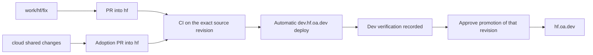

# OA review and release workflow

Status: four-source-branch / eight-environment model accepted by Ryan, 2026-11-10, following Ryan's [team TODOs] and deployment-branch discussion. No branches, protections, environment secrets, live deploy triggers or infrastructure were changed. This is the concrete release plan for the remaining work in [harmonization].

## Accepted first model

Keep `cloud` as the shared code branch and the existing `gcs`, `cw`, `hf`, `r2` branches as their deployment integration branches. Use eight [GitHub deployment environments], named `gcs-dev`, `gcs-prod`, `cw-dev`, `cw-prod`, `hf-dev`, `hf-prod`, `r2-dev`, `r2-prod`. Environments hold release credentials, branch restrictions, approvals and deployment records; they are not additional code forks or isolated databases. Keep the current domains and Pages production/preview branch mappings.

| Source branch | Automatic dev target after successful CI | Production promotion target |
| --- | --- | --- |
| `gcs` | `dev.gcs.oa.dev` / `gcs-dev` | `gcs.oa.dev` / `gcs-prod` |
| `cw` | `dev.cw.oa.dev` / `cw-dev` | `cw.oa.dev` / `cw-prod` |
| `hf` | `dev.hf.oa.dev` / `hf-dev` | `hf.oa.dev` / `hf-prod` |
| `r2` | `dev.r2.oa.dev` / `r2-dev` | `r2.oa.dev` / `r2-prod` |

Feature branches use `work/<deployment>/<slug>` and target that deployment's integration branch through a PR. A shared fix targets `cloud`, then reviewed adoption PRs carry it to each deployment; a deployment-only policy/config change targets that deployment. Generic engine, reader and UI features belong in the shared base, with store-specific configuration kept intrinsic. Do not run a deployment from an uncommitted working tree or use a local push as the release record.

Production promotion names an immutable source SHA and its accepted dev deployment, rather than rebuilding whatever a branch points to later. Dev/prod public build inputs can differ, so do not claim identical asset bytes merely from an identical source SHA; record the environment-specific input/artifact hashes. Reuse the verified artifact when its inputs actually match. Preserve the preceding production deployment/artifact for rollback without rewriting the source branch.

Use the existing [Direct Upload architecture with GitHub Actions][Cloudflare CI uploads]; switching Pages to native Git integration is unnecessary. Refactor the existing guarded deploy helper into build/upload/status operations reusable by the action. CI must use explicit no-push mode; calling today's default production helper would otherwise perform a second Git push after its upload. Shared release logic should be pinned/reviewed and the target allowlist explicit, rather than copying four independent workflows.

## If production should also be selected by Git branches

Use `deploy/{gcs,cw,hf,r2}/{dev,prod}`. Existing branch `gcs` prevents `gcs/prod` or `gcs/dev` from coexisting; `cloud` similarly prevents `cloud/base`. A new `deploy/` prefix avoids renaming those active source branches. Keep `work/<deployment>/<slug>` for feature work and keep `cloud` flat. These are Git reference namespaces, not a reason to move Python's existing `cloud/` source directory.

Eight release branches are viable if a Git ref itself must select production, but should be advancement/promotion references to reviewed source rather than independently edited environment copies. Specify PR/fast-forward/merge-tree semantics before claiming dev's exact SHA was promoted: a normal GitHub merge/squash can create a different commit. Back-propagate any emergency production source change. Do not leave both old and new refs as competing long-term integration branches.

The four-source-branch model is recommended initially because it avoids doubling ongoing merge/drift work. It also preserves current worktrees and owner conventions. A separate protected production ref is optional, not needed to get PR review, automatic dev deploys, release approval or a deployment history.

## Release controls and validation

- Unprivileged PR CI runs before any deployment secrets are available. Do not execute feature/fork code with production credentials through a privileged `pull_request_target` workflow.
- Successful integration-branch CI triggers dev deployment of that exact revision. Verify the source's repository/event, successful conclusion and current intended tip; do not trust a newer unrelated workflow or deploy an obsolete completion over a newer release.
- Production is an explicit approved promotion after dev verification. Record SHA, input hashes, deployment IDs, verification and previous release. Configure release operators so Ryan is not the sole required human during leave. Actual org/role/secret changes are a later reviewed setup step.
- Serialize releases per deployment/environment and recheck intended source before upload. Cancellation must not cut a database/data-generation operation in half. Reject an unverified revision even when a manual action is used.
- Retain full relevant CI coverage, but avoid rerunning the same tests independently for dev and prod. Reuse provenance only when source, lockfiles, test/config inputs and trusted producer agree. Existing pass-cache records are branch-scoped; equal keys do not guarantee cross-branch hits. Do not assume one sibling's cached success proves another revision passed.
- The current CI ignores `*-prod` / `*-dev` pointer pushes. New slash-style release refs do not match those exclusions. Update trigger/filter rules as part of any eight-ref migration rather than accidentally launching eight redundant full suites.
- `Open-Athena/disky` is public and its default branch is currently `front-door` (live readback November 10). Scheduled/manual/event-coordination workflows must be discoverable there where [GitHub requires it][GitHub event restrictions]. Source `push` workflows still need to exist on the triggering source refs. Keep the default-branch orchestration and reusable release implementation consistent.

## Four release lanes

The first pilot automates site releases. It does not imply that scanner images, D1 or infrastructure ship with a Pages upload.

| Lane | Required release behavior |
| --- | --- |
| Site | Frozen build, guarded upload, source/config identity and route/asset smoke; dev first, approved prod promotion |
| Scanner | Build to an explicit candidate, verify clean source stamp, bounded safe smoke, then promote/pin the exact image digest; never build CI candidates straight onto live mutable tags |
| D1 | Read-only schema comparison and explicit unapplied recipe inventory; apply the release's required recipe in compatibility order; no blanket replay of all SQL files |
| Infrastructure/data pointers | Separate plan and reviewed apply/cutover; include current generation/lineage and rollback dependencies; no automatic cleanup or CURRENT move from an ordinary source push |

Store site deployment tokens in the corresponding GitHub environments, with pinned account/project mappings and a shared-vault recovery path. Operators should not need to copy Ryan's `.envrc` to deploy. Keep runtime store/broker/job secrets in their runtime secret stores. Prefer short-lived GitHub-to-GCP federation for image/build operations; document provider permission limits and recovery rather than assuming a token can be scoped more narrowly than its platform allows. This proposal provisions no credentials.

## Dev data and the storage contract

All four currently published dev sites share their deployment's production D1/R2 resources. Branch names and GitHub environments do not change that. Dev verification must label this reality. A real deletion rehearsal uses an explicitly disposable source/prefix and reviewed exact set, or a separately provisioned write sandbox; changing feature code must not accidentally turn a preview into an unchecked production mutation channel.

The intended per-deployment storage split is one GCS data/artifact bucket for pipeline inputs/state and one R2 serving bucket for web reads. Scratch/build resources can remain separately bounded and labelled; record them rather than hiding their spend. Audit web fallback reads, static/interval/age inputs, snapshots, extras and legacy pointers against that split before calling it achieved. Current-generation copies used once by a pipeline and once by serving can be intentional; retained superseded full copies are a separate CS3 issue. Source, serving and scratch resources must remain deployment-owned.

## First team rehearsal and rollout order

1. Implement this accepted branch/environment model with the shared release workflow offline with exact routing/trigger tests. Prepare the environment/credential inventory and branch protection diff; do not activate live triggers before that review.
2. Pilot HF, currently the cleanest history/retirement baseline: Louisa creates a small `work/hf/...` PR, CI verifies it, merge deploys dev, the source/build is checked, then production promotes the reviewed revision. Rehearse rollback too.
3. Carry the same workflow to GCS, CW and R2, changing only the explicit target configuration. Preserve their own image/schema/IaC lanes and intrinsic store differences.
4. Add release revision/deployment results to the fleet status source so the overview can say what actually serves, not merely the branch tip. Finish the daily/monthly status delivery in [fleet plan] independently of a branch rename.

[team TODOs]: https://openathena.slack.com/archives/C0CFMN7FYG4/p1794323273649659
[harmonization]: deployment-cs3-harmonization.md
[fleet plan]: disky-oa-dev.md
[GitHub deployment environments]: https://docs.github.com/en/actions/how-tos/deploy/configure-and-manage-deployments/control-deployments
[Cloudflare CI uploads]: https://developers.cloudflare.com/pages/how-to/use-direct-upload-with-continuous-integration/
[GitHub event restrictions]: https://docs.github.com/en/actions/reference/workflows-and-actions/events-that-trigger-workflows

## Implementation checkpoint: November 10

The accepted model now has a shared controller in `.github/workflows/oa-release.yml`, an explicit target allowlist in `deploy/oa/sites.json`, and `scripts/oa-release` for validated planning, artifact sealing, exact-source deployment records and Cloudflare/live-host readback. `OA_SITE_RELEASE_ENABLED` must explicitly be `true` and `OA_SITE_RELEASE_TARGETS` must be a JSON array of admitted integration names; both default to inactive. Start with `["hf"]` for the pilot. No workflow or trigger has been activated by these source changes.

The controller runs from `front-door`. Its environment uses `deployment: false`, preserving required reviewers and secret gates while avoiding GitHub's implicit controller-SHA deployment record. The approved job creates a deployment explicitly for the source SHA. Required reviewers and wait timers work with this setting; custom GitHub App deployment-protection rules do not. Environment branch policies must admit only `front-door`, not pretend the controller runs on the selected source branch. The planner independently validates the in-repository integration-branch CI or explicit production SHA/proof. Restrict edits to the controller and release policies through review.

Dev releases accept successful push CI only for the current integration tip, and recheck after build and after approval/serialization. Production dispatch supplies the integration name, full SHA and successful dev deployment ID for that SHA. It checks branch ancestry and the latest matching push CI attempt; a newer branch tip need not be promoted. Each release records the prior successful deployment, CI receipt, config hash, artifact hash and workflow URL; the completed receipt adds the Cloudflare deployment ID/URL. Dev/prod builds remain separate because preview build inputs can differ. Both the frontend and precompiled Functions directory (including WASM modules) are sealed before approval; upload uses that complete artifact rather than recompiling unstamped Functions in the credentialed job. CI reuses the source's completed tests rather than running the complete suite twice.

Artifacts are retained 30 days and release receipts 90 days in Actions. Cloudflare owns the deployed artifacts; this implementation does not delete them. A source-based rollback uses the prior full SHA and its dev deployment proof through the same approved production workflow. If ancestry was rewritten or an artifact/proof has expired, stop for an explicit recovery plan; do not bypass validation or fabricate dev acceptance. A cancellation during upload can leave an in-progress GitHub record; reconcile against Cloudflare before retrying.

Before activation: adopt source/build identity support on each integration branch; place the controller and its helper/allowlist on `front-door`; verify the four existing Pages production-branch mappings; provision the eight environments and Pages-only credentials from [credential audit]; use the agreed existing repository write/maintain/admin operators, without adding required environment reviewers or merge approval; then enable the flag for an HF rehearsal. Enable only HF initially with `OA_SITE_RELEASE_TARGETS=["hf"]`, then admit each other deployment after its own prerequisites pass. A successful deployment readback verifies source identity and entry assets; authenticated application/data checks and human dev acceptance remain part of the rehearsal. This does not apply D1 recipes, build scanner images or change infrastructure/data pointers.

The shared site menu now names source ref, environment and the running build; `/api/health` carries full source SHA/ref/environment. “Source on GitHub” uses the source branch, while the build link uses the exact commit. CI explicitly supplies the OA repository, correcting stale branch-local repository values such as CW's old repository name; manual deployment configurations must also adopt `REPO_URL` and `SOURCE_REF` as appropriate.

[credential audit]: ../deploy/oa/CREDENTIALS.md

Validation: 31 focused controller tests cover exact routing, fork/PR rejection, obsolete CI, production dev proof, artifact tampering, clean-source enforcement, account mismatch and credential-name non-disclosure. The broader release/deploy/status suite passed on `mgu`; build/health Vitest suites passed 31 cases there. Both TypeScript projects and the production frontend build passed. Installed Wrangler 4.150.0 compiled the complete Functions directory with its WASM modules; an isolated local Pages runtime served that bundle's full `x-disky-build` stamp without cloud credentials (application identity returned 503 as expected without its runtime bindings, so this is a bundle/stamp check, not an authenticated data smoke). Official actionlint validated both workflows. Native Chrome verification on `http://localhost:13263/` showed `dev · hf · build`, the exact commit link and an actual Source click navigating to `https://github.com/Open-Athena/disky/tree/hf`. This preview uses public R2 data with HF/dev source metadata; it is not an HF deployment.

GitHub readback on November 10 found zero existing deployment environments. The [credential audit] records known role separation and unresolved live-policy checks. Source/build identity commit `563e914c2` has been handed to GCS, CW and HF owners for adoption; this does not claim their live sites changed. No production deployment, branch protection, environment secret, token policy or infrastructure was changed.

The reviewable environment manifest is `deploy/oa/hf-release-setup.json`, generated by `scripts/oa-release setup-plan -t hf -o deploy/oa/hf-release-setup.json`. It admits only the trusted `front-door` controller, has no wait or required reviewer, permits self-approval, and leaves automation disabled. This does not remove the explicit production promotion and successful dev-deployment proof. `hrl20` already has repository maintain access. The foreign-org `marin-community/marin-devs` team cannot be attached as an Open-Athena repository team; existing repo permissions avoid a new hardcoded operator list. No permissions have been changed.

## Rollout status: November 12

hf is the reference deployment. Readback from its owner session at `o/hf` `babe96dd`:

| Item | hf | gcs | cw | r2 |
| --- | --- | --- | --- | --- |
| Release tooling on the integration branch (`scripts/oa-release`, `oa-release.yml`, source/build identity) | yes | yes | yes | yes |
| `<d>-dev` / `<d>-prod` environments | yes | no | no | no |
| In `OA_SITE_RELEASE_TARGETS` | yes | no | no | no |
| Automatic dev release after CI | live (runs 43163896953, 43211681144) | — | — | — |
| Production promotion rehearsed | once (`0fe8aa25`, run 43164201840) | — | — | — |
| Rollback rehearsed | no | — | — | — |
| Deploy notices (`#<d>-admin`) | live | — | — | — |
| `<d>-preview` environment + `PREVIEW_BASES` entry | yes (pilot PR #3: publish, sign-in, retire) | no | no | no |

**cw (owner readback, 2026-11-12):** Pages maps prod → `main` and dev → `dev`; prod, dev, `o/cw` and `o/cw-prod` all at `ea07bac7`. No source blocker: CI runs on `o/cw` pushes (last three green), `site/toml-check` passes. Missing: the `cw-dev`/`cw-prod` environments and a Pages token scoped to `oa-cw-s3-usage`. cw's `[env.preview]` binds prod's D1 (the sweep/staging ledger), so a dev release writes to the real ledger, as manual `--dev` deploys do today. Releases are by hand today (CI on `r`, `site/deploy --dev -P` and `-P` from a pinned checkout, then push `o`). Preview: needs a preview token, `PAGES_SUBDOMAIN = "oa-cw-s3-usage.pages.dev"` in both env blocks, and `OA_LOGIN_ISSUER` plus the broker's preview client (cw has no `OA_LOGIN_*` yet); staging writes from previews probably want gating. Its plan (`8fc2be4b`, local `cw` only) has the same repository-variable bug as gcs's and r2's.

**gcs (owner readback, 2026-11-12):** Pages maps prod → `main` (`production_branch`) and dev → `dev` (`branchAliases`). Cloudflare lists `gcs.oa.dev` as a *deactivated* Pages domain, yet the host serves the current prod build (`x-disky-build` `072530ad`), so something else routes it; the gcs session's token can't read zone routes or Worker domains. A readback through the live host's build header works; anything relying on the Pages domain record won't, until that's explained. Site lane: nothing gcs-specific blocks it (identity adopted, no unapplied D1 recipes, `gcs-prod`/`gcs-dev` both at the serving `072530ad5`); missing are the `gcs-dev`/`gcs-prod` environments and a Pages-only token (the worktree's token is broader). `site/deploy` pushes to `o` after a prod deploy by default, so CI must pass `-P` or go through the controller. Image lane is not CI-ready: `job/build.sh` runs from the laptop, pushes the mutable `:latest` (which the daily scan runs) and re-points `gcs-usage-snapshot-submit` and `gcs-alert-relay`; no candidate tag or promote step. Infra lane: Ryan's `pulumi up -s gcs`. Preview: the preview env has the broker preview client (`OA_LOGIN_PREVIEW_CLIENT_*`) but no `PAGES_SUBDOMAIN` and no `AUTH_HOST_COOKIES` (turning that on signs everyone out once); previews would share prod's D1, R2 and GCS with staging on, so per-PR previews need a write guard or sandbox before activation. Dev lacks `GCP_SA_KEY`, so "Run a scan" is off there.

**r2 (owner readback, 2026-11-12):** Pages maps prod → `r2-prod` and dev → `r2` (`site/deploy.env`, `infra/cf`'s `productionBranch` + `branchAliases`), not `main`/`dev`; r2 keeps it, since moving needs an `infra/cf` apply and re-aliasing `dev.r2.oa.dev` for no functional gain (a separate uniformity decision for Ryan). Pulumi state moved to `gs://oa-pulumi` on 11-11 (OA's ops/pulumi KMS key); deleting the stale local `infra/{cf,gcp}/state/` and the unused passphrase waits for Ryan's go. Blocking the release lane: the `r2-dev`/`r2-prod` environments and their `CF_PAGES_DEPLOY_TOKEN`. Preview: the Pages preview env already has the broker preview client (`oa-r2-usage-preview`) and `PAGES_SUBDOMAIN`, verified signing in on `*.oa-r2-usage.pages.dev`; it still needs an `r2-preview` GitHub environment and a decision that previews read prod's D1/R2, as every dev stack does.

**hf's environment contents (names only), the template for the others:**
- `hf-dev` and `hf-prod`: secrets `CF_PAGES_DEPLOY_TOKEN`, `SLACK_DEPLOY_BOT_TOKEN`; vars `CLOUDFLARE_ACCOUNT_ID`, `DEPLOY_NOTIFICATIONS_ENABLED`, `SLACK_DEPLOY_CHANNEL`; branch policy `front-door`; no required reviewers.
- `hf-preview`: secret `CF_PAGES_DEPLOY_TOKEN`; var `CLOUDFLARE_ACCOUNT_ID`; branch policies `front-door` and `hf`. The `hf` entry is left over from the dropped branch-local `hf-preview.yml` and can go.
- The site config a preview needs on the integration branch: `OA_LOGIN_ISSUER`, `PAGES_SUBDOMAIN` and `AUTH_HOST_COOKIES` in prod and `[env.preview]`, and a `.github/cf-preview.json` target (project, subdomain, `working_directory: ../site`, the Wrangler path, the `/api/health` `x-disky-build` probe; no account id). Cloudflare account and zone ids aren't secret (Ryan, 2026-11-12).

**Generating another deployment's plan:** `OA_SITE_RELEASE_ENABLED` and `OA_SITE_RELEASE_TARGETS` are repository-wide, so `setup-plan` takes their live values and only adds to the list: `scripts/oa-release setup-plan -e "$(gh variable get OA_SITE_RELEASE_ENABLED -R Open-Athena/disky)" -l "$(gh variable get OA_SITE_RELEASE_TARGETS -R Open-Athena/disky)" -t r2 -o deploy/oa/r2-release-setup.json`. Before 2026-11-12 it wrote `["<target>"]` and `false`, which applied as-is would have dropped hf and switched releases off (found by r2; its `591d92b8e` plan needs regenerating).

**Pending D1 recipes hold a release:** `seal` refuses a source whose `site/migrations/` holds any `*.sql`. On a deployment branch a recipe file means it hasn't been applied to that deployment's databases yet; it's applied by the owner with Ryan's go and `git rm`'d, then the release proceeds (suggested by cw, 2026-11-12). Every dev stack shares its prod D1, so code expecting the new schema would otherwise reach a live database before it. `cloud` itself carries recipes for the r2 demo's database (today `admin-list`, `scan-dispatch`, `session-log-actor`), and they come back on every deployment branch that merges `cloud`: **after each `cloud` merge, the owner applies each returned recipe to the deployment's databases (if it isn't already; `dt-cloud d1-schema check -d <db>` tells) or `git rm`s it, before the next release can seal.**

**Deploy tokens:** one Pages token per deployment, set on both its environments. Cloudflare's Pages permission has no per-project scope, so each token can deploy to any Pages project in the OA account; separate tokens buy revocation granularity, not isolation. Ryan mints them in the dashboard (user API token, the single permission Account › Cloudflare Pages › Edit, OA account only) and sets them without printing (`pbpaste | gh secret set CF_PAGES_DEPLOY_TOKEN -e <d>-dev -R Open-Athena/disky`, likewise `-prod`); agents never handle the value.

**Open for hf:** a rollback rehearsal; whether `CF_PAGES_DEPLOY_TOKEN` is Pages-only and project-scoped (the root session installed it); dropping `hf-preview`'s stale `hf` branch policy.
