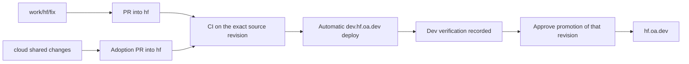

# OA review and release workflow

Status: proposed, 2026-11-10, following Ryan's [team TODOs] and deployment-branch discussion. No branches, protections, environment secrets, live deploy triggers or infrastructure were changed. This is the concrete release plan for the remaining work in [harmonization].

## Recommended first model

Keep `cloud` as the shared code branch and the existing `gcs`, `cw`, `hf`, `r2` branches as their deployment integration branches. Use eight [GitHub deployment environments], named `gcs-dev`, `gcs-prod`, `cw-dev`, `cw-prod`, `hf-dev`, `hf-prod`, `r2-dev`, `r2-prod`. Environments hold release credentials, branch restrictions, approvals and deployment records; they are not additional code forks or isolated databases. Keep the current domains and Pages production/preview branch mappings.

| Source branch | Automatic dev target after successful CI | Production promotion target |
| --- | --- | --- |
| `gcs` | `dev.gcs.oa.dev` / `gcs-dev` | `gcs.oa.dev` / `gcs-prod` |
| `cw` | `dev.cw.oa.dev` / `cw-dev` | `cw.oa.dev` / `cw-prod` |
| `hf` | `dev.hf.oa.dev` / `hf-dev` | `hf.oa.dev` / `hf-prod` |
| `r2` | `dev.r2.oa.dev` / `r2-dev` | `r2.oa.dev` / `r2-prod` |

Feature branches use `work/<deployment>/<slug>` and target that deployment's integration branch through a PR. A shared fix targets `cloud`, then reviewed adoption PRs carry it to each deployment; a deployment-only policy/config change targets that deployment. Generic engine, reader and UI features belong in the shared base, with store-specific configuration kept intrinsic. Do not run a deployment from an uncommitted working tree or use a local push as the release record.

Production promotion names an immutable source SHA and its accepted dev deployment, rather than rebuilding whatever a branch points to later. Dev/prod public build inputs can differ, so do not claim identical asset bytes merely from an identical source SHA; record the environment-specific input/artifact hashes. Reuse the verified artifact when its inputs actually match. Preserve the preceding production deployment/artifact for rollback without rewriting the source branch.

Use the existing [Direct Upload architecture with GitHub Actions][Cloudflare CI uploads]; switching Pages to native Git integration is unnecessary. Refactor the existing guarded deploy helper into build/upload/status operations reusable by the action. CI must use explicit no-push mode; calling today's default production helper would otherwise perform a second Git push after its upload. Shared release logic should be pinned/reviewed and the target allowlist explicit, rather than copying four independent workflows.

## If production should also be selected by Git branches

Use `deploy/{gcs,cw,hf,r2}/{dev,prod}`. Existing branch `gcs` prevents `gcs/prod` or `gcs/dev` from coexisting; `cloud` similarly prevents `cloud/base`. A new `deploy/` prefix avoids renaming those active source branches. Keep `work/<deployment>/<slug>` for feature work and keep `cloud` flat. These are Git reference namespaces, not a reason to move Python's existing `cloud/` source directory.

Eight release branches are viable if a Git ref itself must select production, but should be advancement/promotion references to reviewed source rather than independently edited environment copies. Specify PR/fast-forward/merge-tree semantics before claiming dev's exact SHA was promoted: a normal GitHub merge/squash can create a different commit. Back-propagate any emergency production source change. Do not leave both old and new refs as competing long-term integration branches.

The four-source-branch model is recommended initially because it avoids doubling ongoing merge/drift work. It also preserves current worktrees and owner conventions. A separate protected production ref is optional, not needed to get PR review, automatic dev deploys, release approval or a deployment history.

## Release controls and validation

- Unprivileged PR CI runs before any deployment secrets are available. Do not execute feature/fork code with production credentials through a privileged `pull_request_target` workflow.
- Successful integration-branch CI triggers dev deployment of that exact revision. Verify the source's repository/event, successful conclusion and current intended tip; do not trust a newer unrelated workflow or deploy an obsolete completion over a newer release.
- Production is an explicit approved promotion after dev verification. Record SHA, input hashes, deployment IDs, verification and previous release. Configure release operators so Ryan is not the sole required human during leave. Actual org/role/secret changes are a later reviewed setup step.
- Serialize releases per deployment/environment and recheck intended source before upload. Cancellation must not cut a database/data-generation operation in half. Reject an unverified revision even when a manual action is used.
- Retain full relevant CI coverage, but avoid rerunning the same tests independently for dev and prod. Reuse provenance only when source, lockfiles, test/config inputs and trusted producer agree. Existing pass-cache records are branch-scoped; equal keys do not guarantee cross-branch hits. Do not assume one sibling's cached success proves another revision passed.
- The current CI ignores `*-prod` / `*-dev` pointer pushes. New slash-style release refs do not match those exclusions. Update trigger/filter rules as part of any eight-ref migration rather than accidentally launching eight redundant full suites.
- `Open-Athena/disky` is public and its default branch is currently `front-door` (live readback November 10). Scheduled/manual/event-coordination workflows must be discoverable there where [GitHub requires it][GitHub event restrictions]. Source `push` workflows still need to exist on the triggering source refs. Keep the default-branch orchestration and reusable release implementation consistent.

## Four release lanes

The first pilot automates site releases. It does not imply that scanner images, D1 or infrastructure ship with a Pages upload.

| Lane | Required release behavior |
| --- | --- |
| Site | Frozen build, guarded upload, source/config identity and route/asset smoke; dev first, approved prod promotion |
| Scanner | Build to an explicit candidate, verify clean source stamp, bounded safe smoke, then promote/pin the exact image digest; never build CI candidates straight onto live mutable tags |
| D1 | Read-only schema comparison and explicit unapplied recipe inventory; apply the release's required recipe in compatibility order; no blanket replay of all SQL files |
| Infrastructure/data pointers | Separate plan and reviewed apply/cutover; include current generation/lineage and rollback dependencies; no automatic cleanup or CURRENT move from an ordinary source push |

Store site deployment tokens in the corresponding GitHub environments, with pinned account/project mappings and a shared-vault recovery path. Operators should not need to copy Ryan's `.envrc` to deploy. Keep runtime store/broker/job secrets in their runtime secret stores. Prefer short-lived GitHub-to-GCP federation for image/build operations; document provider permission limits and recovery rather than assuming a token can be scoped more narrowly than its platform allows. This proposal provisions no credentials.

## Dev data and the storage contract

All four currently published dev sites share their deployment's production D1/R2 resources. Branch names and GitHub environments do not change that. Dev verification must label this reality. A real deletion rehearsal uses an explicitly disposable source/prefix and reviewed exact set, or a separately provisioned write sandbox; changing feature code must not accidentally turn a preview into an unchecked production mutation channel.

The intended per-deployment storage split is one GCS data/artifact bucket for pipeline inputs/state and one R2 serving bucket for web reads. Scratch/build resources can remain separately bounded and labelled; record them rather than hiding their spend. Audit web fallback reads, static/interval/age inputs, snapshots, extras and legacy pointers against that split before calling it achieved. Current-generation copies used once by a pipeline and once by serving can be intentional; retained superseded full copies are a separate CS3 issue. Source, serving and scratch resources must remain deployment-owned.

## First team rehearsal and rollout order

1. Agree this branch/environment model and implement the shared release workflow offline with exact routing/trigger tests. Prepare the environment/credential inventory and branch protection diff; do not activate live triggers before that review.
2. Pilot HF, currently the cleanest history/retirement baseline: Louisa creates a small `work/hf/...` PR, CI verifies it, merge deploys dev, the source/build is checked, then production promotes the reviewed revision. Rehearse rollback too.
3. Carry the same workflow to GCS, CW and R2, changing only the explicit target configuration. Preserve their own image/schema/IaC lanes and intrinsic store differences.
4. Add release revision/deployment results to the fleet status source so the overview can say what actually serves, not merely the branch tip. Finish the daily/monthly status delivery in [fleet plan] independently of a branch rename.

[team TODOs]: https://openathena.slack.com/archives/C0CFMN7FYG4/p1794323273649659
[harmonization]: deployment-cs3-harmonization.md
[fleet plan]: disky-oa-dev.md
[GitHub deployment environments]: https://docs.github.com/en/actions/how-tos/deploy/configure-and-manage-deployments/control-deployments
[Cloudflare CI uploads]: https://developers.cloudflare.com/pages/how-to/use-direct-upload-with-continuous-integration/
[GitHub event restrictions]: https://docs.github.com/en/actions/reference/workflows-and-actions/events-that-trigger-workflows
